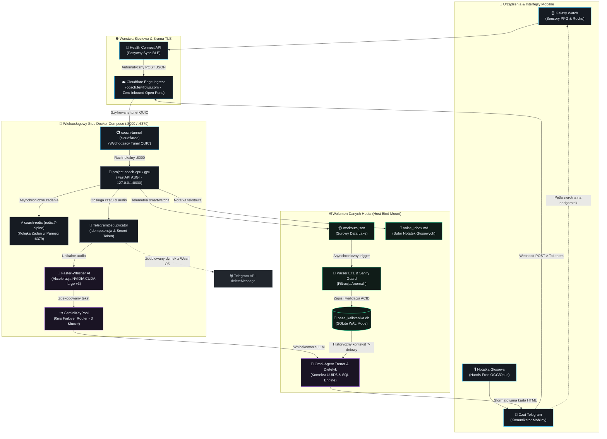

# Architektura Systemu - Project Coach

## 1. Diagram Przepływu Danych (Data Flow Diagram)



## 2. Schemat Bazy Danych

Aktualne tabele zarządzane przez `etl_parser.py`:

*   **`metryki_dzienne`**
    *   `data TEXT PRIMARY KEY`
    *   `kroki INTEGER`
    *   `spalone_kalorie REAL`
    *   `waga REAL`
    *   `hrv_rmssd REAL`
    *   `vo2_max REAL`
    *   `hr_rest INTEGER`
*   **`treningi`**
    *   `id TEXT PRIMARY KEY`
    *   `data TEXT`
    *   `typ TEXT`
    *   `czas_trwania_min REAL`
    *   `hr_avg INTEGER`
    *   `hr_max INTEGER`
    *   `strefa_1_min REAL`
    *   `strefa_2_min REAL`
    *   `strefa_3_min REAL`
    *   `strefa_4_min REAL`
    *   `strefa_5_min REAL`
    *   `notatki_treningowe` (relacyjnie obsługiwana przez ETL)

## 3. Tabela Endpointów API

| Metoda HTTP | Endpoint | Opis |
|---|---|---|
| `POST` | `/telegram-webhook` | Odbiera wiadomości i notatki głosowe z Telegrama. Weryfikuje nagłówek `X-Telegram-Bot-Api-Secret-Token`, transkrybuje audio przez Whisper GPU, wywołuje Omni-Agenta via `GeminiKeyPool` (asynchroniczny wskaźnik typing) i odsyła sformatowaną odpowiedź HTML. |
| `POST` | `/samsung-health` | Dedykowany odbiór telemetrii ze smartwatcha (kroki, kalorie, tętno, treningi). Zapisuje atomowo do Data Lake (`workouts.json`) i asynchronicznie odpala parser ETL. |
| `POST` | `/voice` | Odbiera surowe notatki głosowe z zegarka (`VoiceInboxRequest`). Zapisuje do `voice_inbox.md`. |
| `POST` | `/` *(tryb zgodności)* | Catch-all dla starszych konfiguracji webhooków mobilnych. Zapisuje atomowo do `workouts.json` i triggeruje ETL. |
| `GET` | `/` | Podstawowy healthcheck. Zwraca `{"status": "ok", "server": "FastAPI", "version": "2.0.0"}`. |
| `GET` | `/health` | Rozszerzony stan SRE: stan połączenia z bazą SQLite WAL, szczegółowy status puli kluczy Gemini API oraz stan modelu Whisper. |
| `GET` | `/docs` | Dokumentacja OpenAPI / Swagger UI (wygaszona w środowisku produkcyjnym, aktywna w trybie dev). |

## 4. Konfiguracja Stref Tętna (Heart Rate Zones)

*   **MAX_HR** = 185
*   **Strefa 1:** < 60% (< 111 bpm)
*   **Strefa 2:** 60-70% (111-130 bpm)
*   **Strefa 3:** 70-80% (130-148 bpm)
*   **Strefa 4:** 80-90% (148-167 bpm)
*   **Strefa 5:** 90-100% (167-185 bpm)

> **Heurystyka:** Wartości są wyliczane poprzez pomnożenie liczby próbek (sample counts) przez 5, przy założeniu 5-minutowych interwałów próbkowania z zegarka.

## 5. Zależności Międzyprojektowe

```mermaid
graph LR
    subgraph "Project Coach (Kontener Docker / Port 8000)"
        Srv["server_fastapi.py"]
        ETL["etl_parser.py"]
        DC["docker-compose.yml (Profile CPU/GPU)"]
    end
    
    subgraph "Host Data Volume (Bind Mount /data)"
        VI["voice_inbox.md"]
        WJ["workouts.json"]
        DB[("coach_data.db (WAL)")]
        Log["server_log.txt"]
        R_Diet["Reguła Dietetyk"]
        R_Tren["Reguła Trener"]
    end
    
    Srv -->|Zapis POST /voice| VI
    Srv -->|Atomowy zapis POST /*| WJ
    Srv -->|Logowanie HTTP & SRE| Log
    
    ETL -->|Odczyt| WJ
    ETL -->|Zapis (INSERT/UPDATE)| DB
    ETL -->|Logowanie statusów| Log
    
    VI -.->|Zależność| R_Diet
    DB -.->|Zależność| R_Tren
```

## 6. Procesy w tle i Orkiestracja Usług (Docker Compose)

*   **Docker Compose:** Usługi uruchamiane są w deterministycznym stosie kontenerowym:
    *   `coach-tunnel`: konektor `cloudflared` łączący ruch brzegowy Cloudflare z wewnętrznym serwerem FastAPI po protokole QUIC z zerową liczbą otwartych portów przychodzących i brakiem ekspozycji publicznego IP.
    *   `coach-redis`: in-memory broker kolejki zadań na porcie 6379 z izolacją pętli zwrotnej.
    *   `project-coach-cpu` / `gpu`: aplikacja FastAPI z przypięciem portu do `127.0.0.1:8000`.
*   **Wycofanie procesów hosta:** Wszelkie dawne procesy `ngrok.exe` oraz `pythonw.exe` działające na hoście zostały trwale wygaszone na rzecz kontenerów Docker, co gwarantuje zasadę Single-Writer dla bazy SQLite WAL.

## 7. Środowisko Hosta i Zarządzanie Energią (Power Management SRE)

Dla zapewnienia nieprzerwanej dostępności usług w architekturze Modern Standby (S0 Low Power Idle) na dedykowanym hoście z GPU NVIDIA:
*   **Zasilanie sieciowe (AC):**
    *   Wyłączenie ekranu (`VIDEOIDLE`): 5–15 min (bezpieczne odcięcie zasilania matrycy bez dławienia procesów).
    *   Uśpienie (`STANDBYIDLE`): **Nigdy (0)** – uśpienie S0 zamraża procesy wykonawcze, usypia GPU (CUDA) i zrywa tunele sieciowe.
    *   Hibernacja (`HIBERNATEIDLE`): **Nigdy (0)**.
    *   Akcja zamknięcia pokrywy (`LIDACTION`): **Nic nie rób (0)**.
*   **Ochrona baterii (Conservation Mode):**
    *   Włączony **Tryb konserwacji** blokujący ładowanie do ~75–80%, eliminujący degradację ogniw Li-Ion i ryzyko spuchnięcia baterii przy pracy 24/7 pod ładowarką.
*   **Odporność na restarty (Windows Update):**
    *   Włączenie w *Konta → Opcje logowania* opcji automatycznego dokończenia konfiguracji po aktualizacji (ARSO - Automatic Restart Sign-On), co gwarantuje podniesienie sesji i skryptu `start_serwera.vbs`.

## 8. Silnik Idempotencji i Deduplikacji (TelegramDeduplicator & Auto-Purge)

W celu eliminacji błędu wielokrotnego wysyłania tych samych notatek głosowych ze smartwatchy (Samsung Galaxy Watch z Wear OS) w potoku sieciowym wdrożono:
*   **Pamięciowy Rejestr Unikalności (`TelegramDeduplicator`):** Śledzi globalne identyfikatory `file_unique_id` (audio, TTL 300s), skróty treści tekstowej (TTL 5s) oraz `update_id` webhooków (TTL 300s), synchronizowany przez `threading.Lock`.
*   **Auto-Purge w UI Telegrama:** Po wykryciu duplikatu serwer natychmiast przerywa przetwarzanie i asynchronicznie wywołuje `deleteMessage` na identyfikatorze drugiej wiadomości. Eliminuje to nadmiarowy dymek na ekranie zegarka/telefonu użytkownika.
*   **Serializacja Sesji Agenta (`get_chat_lock`):** Zabezpiecza przed współbieżnym odpytywaniem tego samego `conversation_id` przy szybkim nadejściu kilku różnych wiadomości, chroniąc bazę sesji i limit 5 RPM w darmowym tierze Gemini API.

## 9. SRE Watchdog i Wskaźnik UX Telegrama (Self-Healing & Typing Feedback)

*   **Pętla SRE Watchdog (`start_watchdog`):** Dedykowany mechanizm nadzoru stanu integracji:
    *   **Monitor Łączności Tunelu:** Weryfikacja statusu połączenia wychodzącego konektora Cloudflare oraz eliminacja zatorów kolejki.
    *   **Audyt i Auto-Flush Webhooka Telegrama (co 5 min):** Odpytuje `getWebhookInfo`. W przypadku zalegających aktualizacji (`pending_update_count > 0`), automatycznie wymusza oczyszczenie kolejki (`drop_pending_updates=True`) i rejestruje incydent w logach.
*   **Wskaźnik UX Typing (`TelegramTypingAction`):** Wątek tła pulsujący akcją `sendChatAction: typing` co 4 sekundy od momentu wpłynięcia żądania do wysłania odpowiedzi. Zapewnia natychmiastową informację zwrotną dla użytkownika podczas lokalnej transkrypcji Whisper (GPU) oraz wnioskowania modelu LLM.
*   **Autonomia Narzędziowa & Sanitizer Odmów:** Konfiguracja agenta z polityką `policy.allow_all()` eliminującą fałszywe blokady `confirm_run_command` w trybie bezgłowym oraz filtr regex w `format_telegram_message` wycinający ewentualne komunikaty odmowy harnessu.


